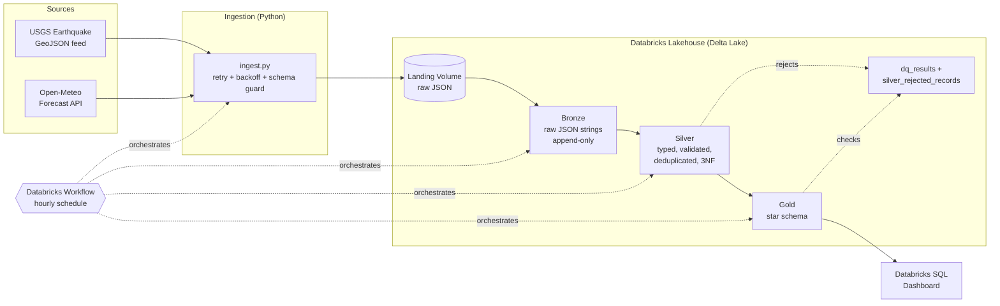

# Architecture

## Layers

| Layer | Tables | Purpose |
|---|---|---|
| Landing | Volume `landing/usgs`, `landing/openmeteo` | Immutable raw API responses (replayable) |
| Bronze | `bronze_usgs_events`, `bronze_openmeteo_weather` | Raw JSON string + lineage (`_source_file`, `_ingested_at`). Tolerates schema drift |
| Silver | `silver_earthquake_event`, `silver_weather_observation`, `silver_place`, `silver_region`, `silver_network`, `silver_weather_code`, `silver_rejected_records` | Parsed, typed, validated, deduplicated, normalized (3NF) |
| Gold | `gold_fact_earthquake_weather` + 6 `gold_dim_*` | Star schema for BI |
| Ops | `dq_results` | Data-quality history |

## Local mirror
The same logic runs locally on SQLite (`src/`, `sql/`) so the pipeline can be tested without a cluster (`pytest`).
Databricks notebooks (`databricks/`) are the production implementation.

## Design decisions
* **Why Bronze stores JSON strings:** USGS/Open-Meteo can add fields at any time; storing raw JSON means ingestion never breaks. Silver parses with an explicit schema and ignores unknown fields.
* **Why two weather timestamps are possible per event:** weather is fetched on every run, so a repeating event accumulates observations; the star schema keeps the latest one per event.
* **Secrets:** both APIs are keyless. `.env` / Databricks secret scopes are the pattern if a key is added (see `.env.example`).
