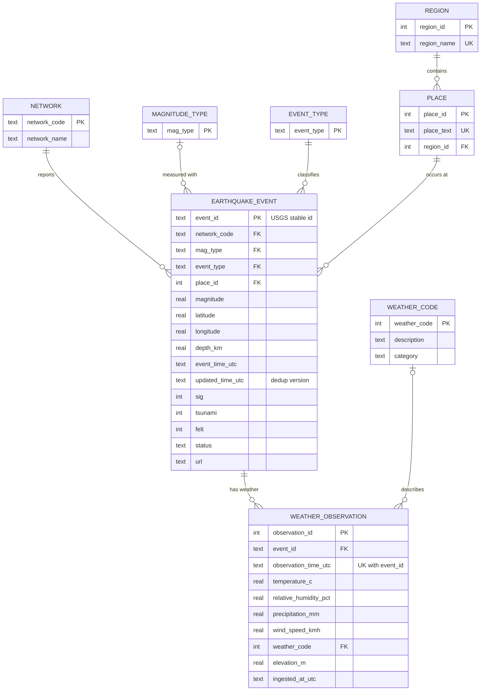

# Normalized (3NF) ER diagram

Implemented in `sql/create_tables.sql` (local) and the `silver_*` tables (Databricks).

Operational tables (not part of the business model): `ingestion_log` (file lineage + idempotency), `rejected_record` (quarantine).

## Why this is 3NF
* **1NF** – every column is atomic; the GeoJSON `coordinates` array is split into `longitude`, `latitude`, `depth_km`; the Open-Meteo `current` object is flattened.
* **2NF** – every table has a single-column key (except `weather_observation`'s natural key, whose non-key columns depend on the whole `(event_id, observation_time)` pair).
* **3NF** – transitive dependencies removed: `event → place → region` (place text determines region), `event → network → network_name`, `weather_code → description/category`.
