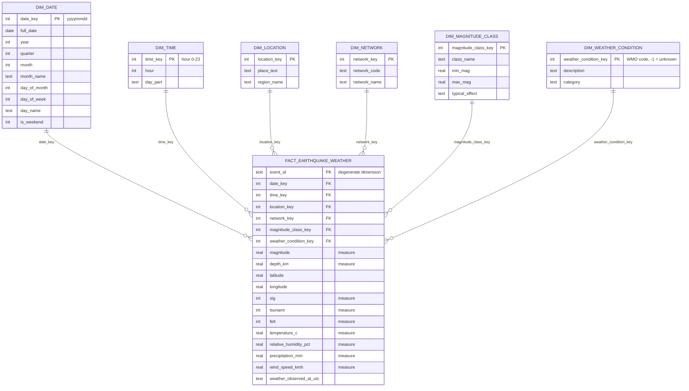

# Star schema

**Grain:** one row per earthquake event, enriched with the *most recent* weather observation at its epicentre.
Built by `sql/transform_star.sql` (local) and `databricks/04_gold.py` (Databricks).

## Modelling notes
* Events without a weather reading point to the **Unknown (-1)** weather member, so inner joins never drop earthquakes.
* `dim_magnitude_class` bands are half-open `[min, max)`.
* `dim_date` is generated as a *continuous* calendar between the first and last event date (no gaps).
* Dimension keys in Databricks are deterministic (`xxhash64` / ordered `row_number`) so full rebuilds are repeatable.

## Example business questions
| Question | Tables |
|---|---|
| Which regions have the most / strongest quakes? | fact + dim_location |
| Do large quakes cluster at a time of day? | fact + dim_time |
| What was the weather at the epicentre during major quakes? | fact + dim_weather_condition + dim_magnitude_class |
| Which seismic network reports the most events? | fact + dim_network |
